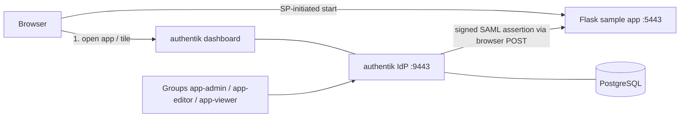
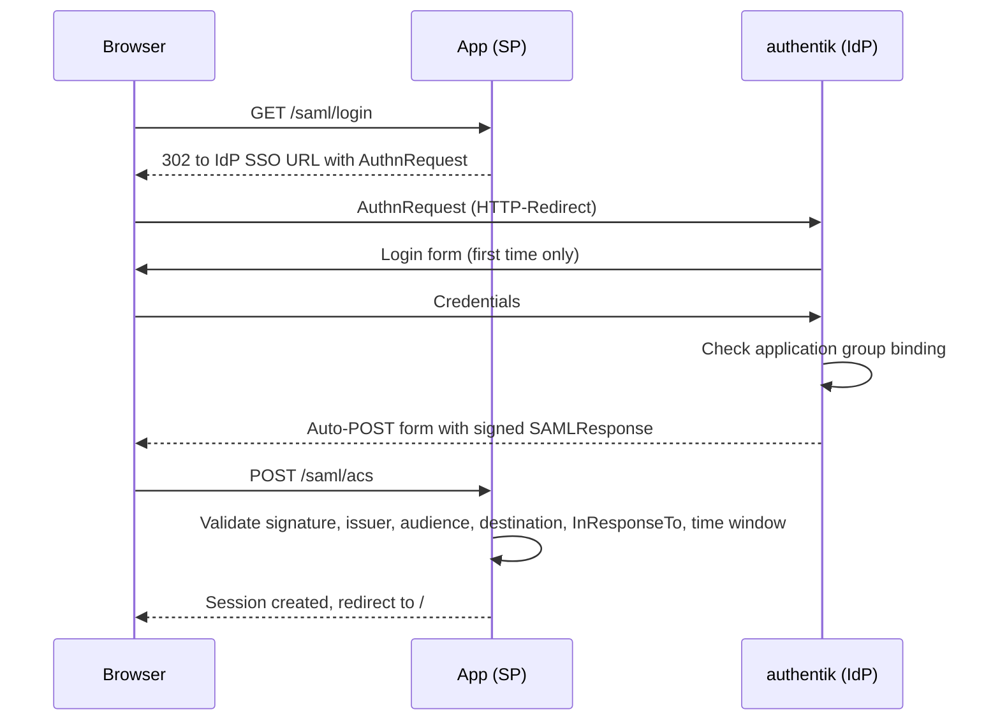
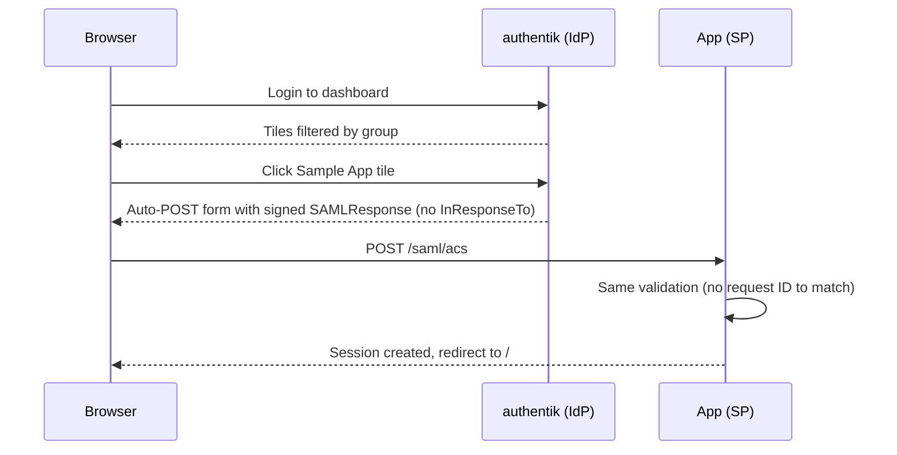

# Architecture

## Components and tool choice
| Component | Choice | Justification |
|---|---|---|
| IdP | authentik | Open source, official Docker Compose, native SAML provider, groups, policy bindings, MFA available |
| Dashboard | authentik application library | Shows only applications the user is entitled to (group bindings) and starts IdP-initiated login from a tile; no custom code to maintain |
| Sample app (SP) | Flask + python3-saml | Small codebase, strict validation of signature, audience, issuer, destination and time window |

## Architecture diagram

## SP-initiated login

## IdP-initiated login

## RBAC
The IdP maps groups to the `role` attribute (app-admin to Admin, app-editor to Editor, app-viewer to Viewer).
The app copies `role` from the assertion into its session and checks it on the server for every request:
`/general` needs Admin, Editor or Viewer; `/admin` needs Admin. Hiding buttons is not relied on; direct URL access returns 403.
